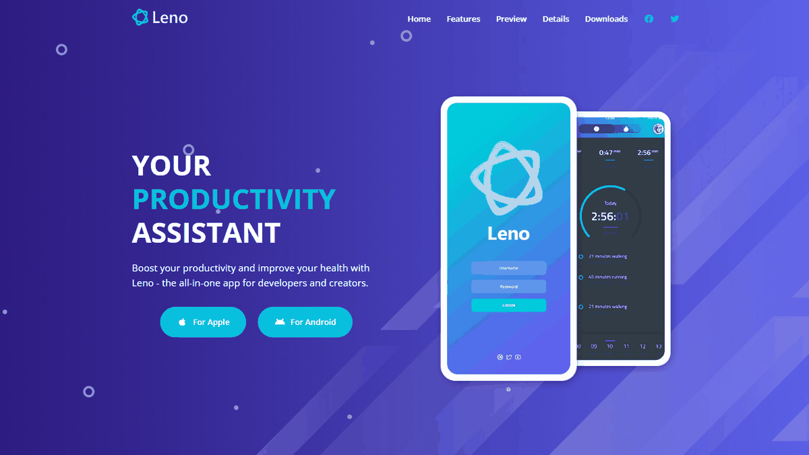
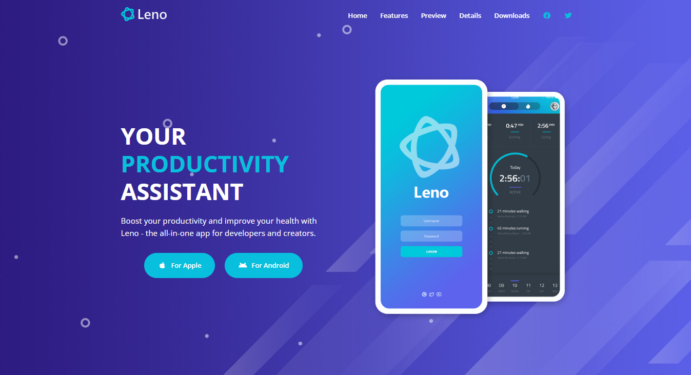
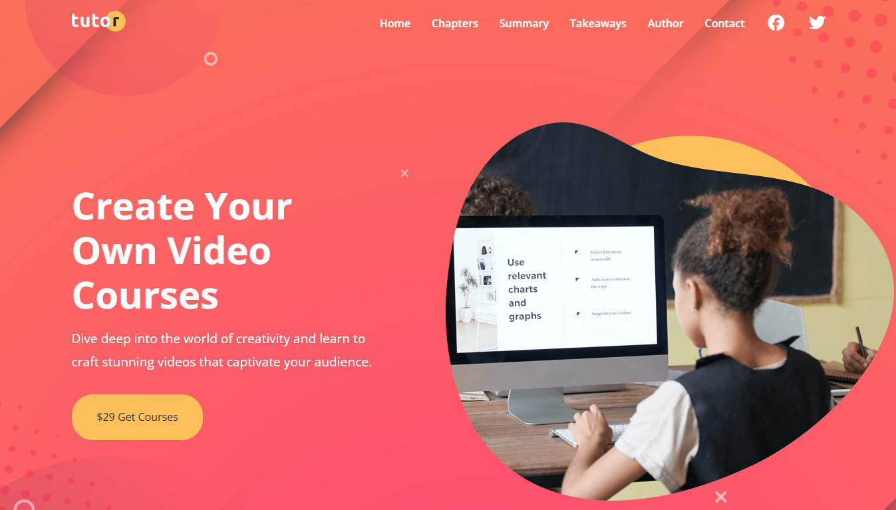
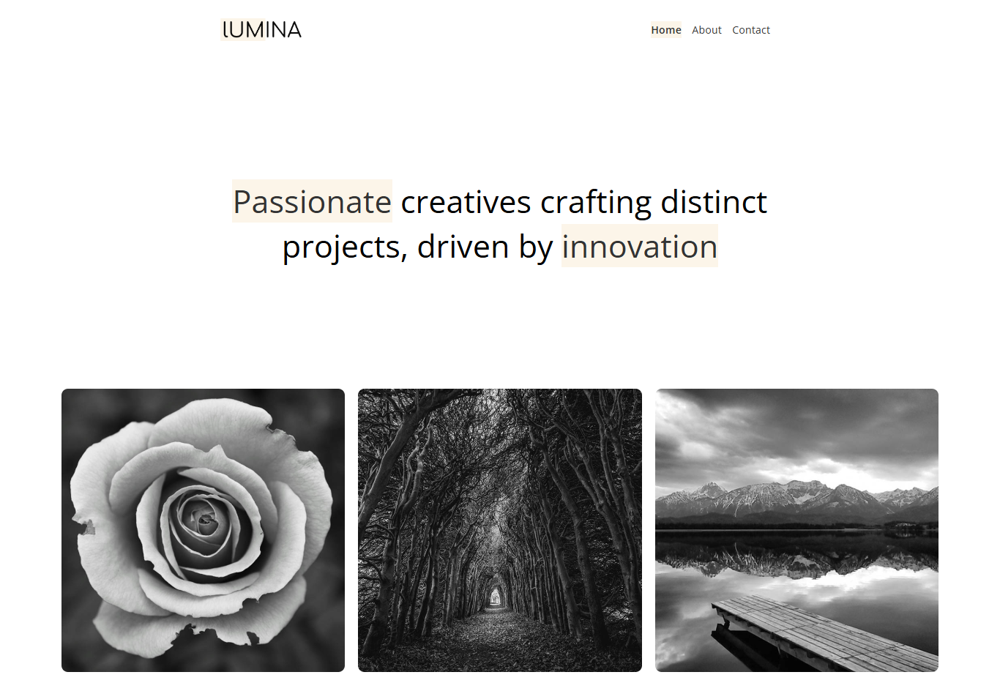

# Modern HTML & CSS From The Beginning 2.0

<p align="center">
  
  
  
  
  
  
  
  
  
</p>

Welcome to the comprehensive learning and project repository for **Modern HTML & CSS From The Beginning 2.0**. This repository documents a complete journey from core HTML/CSS fundamentals to advanced modern web layout techniques, responsive architecture, web accessibility (a11y), modern CSS features (CSS Grid, Flexbox, Container Queries, CSS Nesting), and full-scale real-world projects.

---

<details>
<summary>📚 Table of Contents</summary>

<br>

- [🎬 Featured Real-World Projects](#-featured-real-world-projects)
  - [1. Leno Mobile App](#1-leno-mobile-app)
  - [2. Tutor Website](#2-tutor-website)
  - [3. Lumina Creative Agency Website](#3-lumina-creative-agency-website)
  - [4. Mini-Projects & Practice Challenges](#4-mini-projects--practice-challenges)
- [📖 Course Curriculum & Section Breakdown](#-course-curriculum--section-breakdown)
- [🧠 Key Skills & Concepts Mastered](#-key-skills--concepts-mastered)
- [🚀 Getting Started Locally](#-getting-started-locally)
- [👤 Author & Credits](#-author--credits)

</details>

---

## 🎬 Featured Real-World Projects

<table width="100%">
  <tr>
    <td valign="middle">
      <h3>Live Project Showcase — Slider</h3>
    </td>
    <td align="right" valign="middle">
      
    </td>
  </tr>
</table>

<p align="center">
  
</p>

### ⚡ Live Demos Quick Access

| Project | Live Demo | Source Code |
| :--- | :--- | :--- |
| **Leno App** | [leno-apps.vercel.app](https://leno-apps.vercel.app/) | [`section19-20 Leno Website`](<./section19-20%20Leno%20Website>) |
| **Tutor Site** | [tutor-site-brown.vercel.app](https://tutor-site-brown.vercel.app/) | [`section17-18 Tutor Website`](<./section17-18%20Tutor%20Website>) |
| **Lumina Creative** | [lumina-creative-psi.vercel.app](https://lumina-creative-psi.vercel.app/) | [`section11 Lumina creative Website`](<./section11%20Lumina%20creative%20Website>) |

---

### 1. Leno Mobile App

[](https://leno-apps.vercel.app/)

- **Live Demo:** [https://leno-apps.vercel.app](https://leno-apps.vercel.app/)
- **Directory:** [`section19-20 Leno Website`](<./section19-20%20Leno%20Website>)
- **Description:** A modern, high-converting, and sleek landing page for Leno — the all-in-one productivity and health assistant mobile application tailored for creators, developers, and professionals.
- **Key Highlights:**
  - Dynamic responsive navigation with mobile hamburger menu
  - Video presentation section with video frame modal preview
  - Interactive screenshots showcase & details modal
  - Testimonials carousel/grid, pricing table, and newsletter download area
  - Clean semantic HTML structure and modular CSS architecture
- **Tech Stack:** HTML5, CSS3, Vanilla JavaScript, Font Awesome, Google Fonts (Open Sans)

---

### 2. Tutor Website

[](https://tutor-site-brown.vercel.app/)

- **Live Demo:** [https://tutor-site-brown.vercel.app](https://tutor-site-brown.vercel.app/)
- **Directory:** [`section17-18 Tutor Website`](<./section17-18%20Tutor%20Website>)
- **Description:** A modern, responsive, and visually appealing landing page website for an online video course and tutorial platform.
- **Key Highlights:**
  - Hero header with high-impact CTA and course overview
  - Chapter breakdown cards with custom SVG icons
  - Stats counter section and reader testimonials
  - Dedicated author profile, partner showcase, and newsletter subscription form
  - Accessible interactive mobile navigation
- **Tech Stack:** HTML5, CSS3, Vanilla JavaScript, Font Awesome, Google Fonts

---

### 3. Lumina Creative Agency Website

[](https://lumina-creative-psi.vercel.app/)

- **Live Demo:** [https://lumina-creative-psi.vercel.app](https://lumina-creative-psi.vercel.app/)
- **Directory:** [`section11 Lumina creative Website`](<./section11%20Lumina%20creative%20Website>) / [`section12 Github`](<./section12%20Github>)
- **Description:** A modern, responsive, and minimalist website designed for creative agencies, photography studios, and digital designers.
- **Key Highlights:**
  - Multi-page routing and consistent navigation header/footer
  - Interactive portfolio gallery with Lightbox integration
  - Team showcase cards and services overview
  - Accessible contact forms and integrated social media links
- **Tech Stack:** HTML5, CSS3, Lightbox2, Font Awesome

---

### 4. Mini-Projects & Practice Challenges

| Project / Challenge | Section | Path |
| :--- | :---: | :--- |
| **Landing Form** | 9 | [`section9 Landing Form`](<./section9%20Landing%20Form>) |
| **Shoe Cards Project** | 6 | [`section6 .../10-shoe-cards-project`](<./section6%20Box%20Model%20and%20Positioning/10-shoe-cards-project>) |
| **Freelance Form Project** | 6 | [`section6 .../09-freelance-form-project`](<./section6%20Box%20Model%20and%20Positioning/09-freelance-form-project>) |
| **Pricing Card Challenge** | 7 | [`section7 Flexbox/06-pricing-card-challenge`](<./section7%20Flexbox/06-pricing-card-challenge>) |
| **Responsive Pricing Grid** | 8 | [`section8 Responsive Design/05-responsive-pricing-grid`](<./section8%20Responsive%20Design/05-responsive-pricing-grid>) |
| **CSS Selectors Challenge** | 14 | [`section14 Advanced Selectors/10-selectors-challenge`](<./section14%20Advanced%20Selectors/10-selectors-challenge>) |
| **CSS Grid Layout Challenges** | 15 | [`section15 CSS Grid`](<./section15%20CSS%20Grid>) |

---

## 📖 Course Curriculum & Section Breakdown

| Section | Title | Category | Key Topics |
| :---: | :--- | :--- | :--- |
| 1 | [Introduction](<./section1%20Inroduction>) | HTML | Setup, basic document structure, developer workflow |
| 2 | [Essential HTML](<./section2%20Essential%20html>) | HTML | Meta tags, headings, lists, links, images, semantic markup, Emmet |
| 3 | [HTML Forms & Input Elements](<./section3%20Html%20Form%20and%20input%20elements>) | HTML | Text inputs, textareas, selects, radio, checkboxes, datalists, form attributes |
| 4 | [More HTML Elements](<./section4%20More%20Html%20Elements>) | HTML | Audio/video, image maps, tables, iframes, SVG, `<dialog>`, popovers, progress |
| 5 | [CSS Basics](<./section5%20CSS%20basics>) | CSS | Selectors, typography, color models (HEX/RGB/HSL), backgrounds, specificity |
| 6 | [Box Model & Positioning](<./section6%20Box%20Model%20and%20Positioning>) | CSS | Sizing, overflow, margin collapse, padding, borders, display, positioning |
| 7 | [Flexbox](<./section7%20Flexbox>) | CSS | Flex containers & items, `justify-content`, `align-items`, `flex-wrap`, `gap` |
| 8 | [Responsive Design](<./section8%20Responsive%20Design>) | CSS | Fluid layouts, `rem`/`em`, viewport units, media queries, Container Queries |
| 9 | [Landing Form Mini-Project](<./section9%20Landing%20Form>) | Project | Complete responsive landing form with modern typography |
| 10 | [Various CSS Features](<./section10%20Various%20CSS%20featues>) | CSS | Custom Properties, filters, smooth scroll, sticky nav, `calc()`, CSS Nesting |
| 11 | [Lumina Creative Website](<./section11%20Lumina%20creative%20Website>) | Project | Full multi-page agency website · [Live Demo](https://lumina-creative-psi.vercel.app/) |
| 12 | [Git & GitHub Workflow](<./section12%20Github>) | Tooling | Version control, branching, commits, `.gitignore`, GitHub deployment |
| 13 | [Web Accessibility (a11y)](<./section13%20Web%20Accessibility>) | A11y | Screen readers, ARIA roles, keyboard navigation, focus management |
| 14 | [Advanced Selectors](<./section14%20Advanced%20Selectors>) | CSS | Attribute selectors, combinators, pseudo-elements, `:has()`, `:is()`, `:where()` |
| 15 | [CSS Grid](<./section15%20CSS%20Grid>) | CSS | 2D layouts, `grid-template`, `repeat()`, `minmax()`, auto-fill/fit, named areas |
| 16 | [Transitions & Animation](<./section16%20Transition%20animation>) | CSS | CSS transitions, timing functions, keyframe animations, JS integration |
| 17–18 | [Tutor Website Project](<./section17-18%20Tutor%20Website>) | Project | Full-scale course landing page with mobile menu · [Live Demo](https://tutor-site-brown.vercel.app/) |
| 19–20 | [Leno Mobile App Website](<./section19-20%20Leno%20Website>) | Project | Capstone with modals, interactive galleries, JavaScript interactions · [Live Demo](https://leno-apps.vercel.app/) |
| 21 | [Production & Deployment](./section21) | Tooling | Project finalization, optimization, production deployment |

---

## 🧠 Key Skills & Concepts Mastered

- **Semantic HTML5:** Native landmark elements, accessible forms, tables, media handling, and SVG integration.
- **Modern CSS Layouts:** Mastering Flexbox (1D) and CSS Grid (2D) for complex, adaptable UI patterns.
- **Responsive Web Design:** Fluid grids, media queries, mobile-first design philosophy, modern Container Queries.
- **Modern CSS Features:** CSS custom properties, native CSS nesting, `:has()`, `:is()`, `:where()`, `calc()`, and filters.
- **Web Accessibility (a11y):** Screen reader friendliness, keyboard navigation, semantic ARIA roles & attributes.
- **UI Interactivity:** Modal dialogs, mobile navigation draw-outs, smooth scroll navigation, and Lightbox galleries using Vanilla JavaScript.
- **Professional Workflow:** Clean directory organization, modular code separation, version control with Git & GitHub.

---

## 🚀 Getting Started Locally

To explore or run any of the projects and practice sections locally:

1. **Clone the repository:**

   ```bash
   git clone https://github.com/sajidsam/UdemyCourse.git
   cd UdemyCourse
   ```

2. **Open with VS Code or any text editor:**

   ```bash
   code .
   ```

3. **Run using Live Server:**

   - Install the **Live Server** extension in VS Code.
   - Right-click on any `index.html` file (e.g., inside `section19-20 Leno Website` or `section17-18 Tutor Website`).
   - Select **"Open with Live Server"** to view it with hot-reload in your browser.

---

## 👤 Author & Credits

- **Developer:** [Sajidul Islam (@sajidsam)](https://github.com/sajidsam)
- **Repository:** [sajidsam/UdemyCourse](https://github.com/sajidsam/UdemyCourse)

---
